# SneakerDrop — Premium Sneaker Showcase

> Limited pairs. Zero compromise.

SneakerDrop is a showcase for a fictional sneaker brand. It has a **scroll-driven 3D hero**, a catalogue served from a **real Postgres database (Supabase)**, a **per-product email waitlist**, and a **protected admin dashboard** for managing sneakers and viewing signups.

**Live site:** https://sneakerdrop-rho.vercel.app · **Admin:** https://sneakerdrop-rho.vercel.app/admin · **Repo:** https://github.com/Abh1shxkk/sneakerdrop

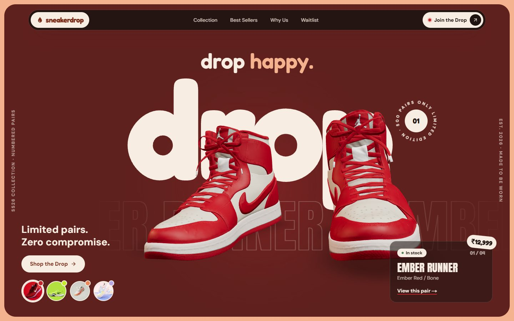

---

## Features

### Public site
- **3D scroll hero.** A real Air Jordan 1 pair rendered with three.js / React Three Fiber, pinned with GSAP ScrollTrigger. As you scroll it spins a full 360°, then tilts to a ¾ angle while four feature callouts appear, then flips to a top-down view as the panel colour shifts. It follows the mouse and bobs when idle.
- **Colourway swatches with a colour flood.** The round thumbnails in the hero come from the database. Picking one recolours the 3D shoe to that product's `accent_hex` and floods the whole hero in that colour with a circular wipe that starts from the swatch you clicked. A rotating "limited edition" stamp, an outlined product-name band, vertical side labels and a price sticker update with it.
- **Smart header.** An announcement ticker, a drop-shaped logo mark, a sliding highlight that follows the section you're viewing, and a header that hides as you scroll down and returns as you scroll up.
- **Crossing tape marquee.** Two tilted streetwear-style bands running in opposite directions.
- **Best sellers deck.** Featured pairs in a fanned card deck you can drag or swipe, a giant flipping rank number, a background tinted to each pair's colour, and segmented progress bars that auto-advance and pause on hover.
- **Back to top.** A floating button with a ring that fills as you scroll, using Lenis smooth scrolling.
- **Collection grid.** Every product from the database, with animated filter chips by availability, 3D tilt-on-hover cards and staggered reveal on scroll.
- **"Find your colourway" panels.** Expanding colour panels, one per product in its own accent colour, that open on hover to show the pair. Text colour switches between light and dark automatically for contrast. On mobile they become a stack of colour bars.
- **"Built different" bento.** Colour-blocked tiles with a feature image, count-up stats and hover micro-interactions.
- **Product pages** (`/sneakers/[slug]`). Pre-built at deploy so they open instantly. Each page is tinted in the pair's colour, with a gallery of close-up views and a hover magnifier, a details column that stays in view as you scroll, highlight chips, a waitlist card whose copy changes with stock status, expandable shipping, materials and authenticity sections, a "Next pair" banner and related products.
- **Waitlist "drop list" ticket.** A perforated drop-pass ticket tinted in the chosen pair's colour, with a tear-off stub showing a pass number, a live countdown to the next Friday drop and a barcode. Validated on the client and the server, saved in the database, blocks the same email signing up twice for one product, and includes a honeypot field against bots. Success and "already on the list" states are animated.
- **Colourful footer.** A strip made of every product's colour, "Don't miss the next drop" butter and sky cards, a live Mumbai studio clock, colourway chips that link to each pair, and a multicolour wordmark that runs edge to edge and sits flush on the bottom of the page.
- A custom "View" / "Notify" cursor bubble over product cards (desktop), smooth scrolling (Lenis), a full-screen animated mobile menu, a marquee strip, a skip link, and `prefers-reduced-motion` support.

### Admin dashboard (`/admin`)
- Email and password login (Supabase Auth). Only users listed in the `admins` table get in.
- Product **create, edit and delete**, with image upload to Supabase Storage or an Unsplash URL, auto-generated slug, and an accent colour picker.
- **Availability** and **featured** can be changed straight from the table.
- **Waitlist view** with a per-product filter, counts, entry removal and **CSV export**.
- Stats tiles, toasts, a confirmation modal before deleting, and empty and loading states.
- Every change refreshes the public pages at once (`revalidatePath`).

---

## Assignment requirements

| Requirement | Where it lives |
|---|---|
| Premium landing page with animations and a responsive layout | `src/app/(site)/page.tsx` and `src/components/site/*`: 3D scroll hero, colour flood, draggable deck, colourway panels, ticket waitlist, mobile menu |
| Dynamic catalogue from a real database (name, image, price, description, availability) | Supabase `products` table, read in `src/lib/queries.ts`. No hardcoded product arrays. 9 seeded pairs. |
| Protected admin: add, edit and delete sneakers and change availability | `/admin` with Supabase Auth + `admins` table, `src/actions/products.ts`, enforced by RLS. Changes revalidate the public pages. |
| Waitlist with validation, persistence, duplicate prevention and admin view | `src/actions/waitlist.ts` (Zod + honeypot), `CHECK` constraint, unique `(product_id, lower(email))` index, `/admin/waitlist` with filter and CSV export |
| No write credentials exposed to the public | Only the public anon key ships. No service-role key. RLS blocks anon writes to products and all reads of the waitlist. |

---

## Tech stack

| Layer | Tech |
|---|---|
| Framework | Next.js 15 (App Router, Server Components, Server Actions), React 19, TypeScript (strict) |
| Styling | Tailwind CSS v4 with design tokens in `globals.css` |
| Database / Auth / Storage | Supabase (Postgres + Row Level Security, Auth, Storage) |
| 3D | three.js, @react-three/fiber, @react-three/drei |
| Motion | GSAP + ScrollTrigger, Lenis, Motion (Framer Motion) |
| Validation | Zod |
| UI | lucide-react, sonner |
| Fonts | Fredoka (display), Anton (headlines), DM Sans (body), self-hosted from `@fontsource` via `next/font/local` so builds never depend on Google Fonts |
| Hosting | Vercel |

---

## Getting started

### 1. Clone and install
```bash
git clone https://github.com/Abh1shxkk/sneakerdrop.git && cd sneakerdrop
npm install
```

### 2. Create the Supabase project
1. Create a project at [supabase.com](https://supabase.com).
2. **SQL Editor:** run [`supabase/schema.sql`](supabase/schema.sql), then [`supabase/seed.sql`](supabase/seed.sql).
3. **Authentication → Providers → Email:** turn **off** "Allow new users to sign up".
4. **Authentication → Users → Add user:** create your admin with an email and password, and tick "Auto confirm".
5. Make that user an admin (SQL Editor):
   ```sql
   insert into public.admins (user_id)
   select id from auth.users where email = 'you@example.com';
   ```

### 3. Environment variables
```bash
cp .env.example .env.local
```
Fill in the values from **Project Settings → API**:
```
NEXT_PUBLIC_SUPABASE_URL=https://xxxx.supabase.co
NEXT_PUBLIC_SUPABASE_ANON_KEY=eyJ...
```
> The service-role key is **never** used by this app.

### 4. Run
```bash
npm run dev      # http://localhost:3000
npm run build    # production build
```

### Deploy (Vercel)
Import the repo into Vercel, add the two environment variables, and deploy.

---

## Database schema

Full SQL: [`supabase/schema.sql`](supabase/schema.sql)

```
products
  id uuid PK · slug text UNIQUE · name · tagline · description
  price_cents int (≥0) · image_url · colorway · accent_hex (#RRGGBB)
  availability enum(available | low_stock | sold_out | coming_soon)
  featured bool · sort_order int · created_at · updated_at (trigger)

waitlist
  id uuid PK · product_id → products.id (ON DELETE CASCADE)
  email (CHECK format) · created_at
  UNIQUE INDEX (product_id, lower(email))     ← duplicate prevention

admins
  user_id → auth.users.id PK

is_admin()  security-definer function: is auth.uid() listed in admins?
product_waitlist_counts  view (security_invoker): product_id, total
```

### Row Level Security

| Table | anon / public | admin (`is_admin()`) |
|---|---|---|
| products | SELECT | INSERT, UPDATE, DELETE |
| waitlist | **INSERT only** (can never read emails) | SELECT, DELETE |
| admins | — | SELECT own row |
| storage `product-images` | read | upload / update / delete |

---

## Architecture & technical decisions

```
Browser ──► Next.js on Vercel
             ├─ Server Components ── cookie-less anon client ──► products (public read, cached)
             ├─ Server Action joinWaitlist ── anon ──► waitlist (insert-only RLS)
             ├─ Server Actions (admin CRUD) ── user's session cookie ──► RLS is_admin()
             └─ middleware.ts ── refreshes session, redirects /admin/* when signed out
```

1. **No service-role key anywhere.** Every admin write runs as the logged-in user, and Postgres RLS (`is_admin()`) decides whether it is allowed. Even if someone took the public anon key, they could not change products or read the waitlist.
2. **Three layers of admin protection:** the middleware redirect, a `requireAdmin()` / `getAdmin()` check in the admin layout and in *every* server action, and RLS in the database.
3. **The database stops duplicates.** A unique index on `(product_id, lower(email))` blocks repeat signups, even if two requests arrive at the same moment. The action turns Postgres error `23505` into a friendly "you're already on the list".
4. **Validation at every layer:** Zod on the server (the source of truth), a quick check in the browser for better UX, and `CHECK` constraints in Postgres.
5. **Fast public pages that stay fresh.** Product pages are pre-built at deploy (`generateStaticParams`), queries are de-duplicated with React `cache()`, and server functions run in Mumbai (`bom1`) next to the database. Public reads use a client without cookies, so pages can be cached (`revalidate = 60`). Admin changes call `revalidatePath()`, so updates appear at once.
6. **One real 3D model, any colourway.** The hero uses a single glTF Air Jordan 1 pair, compressed from 8.1 MB to about 1 MB (WebP textures plus meshopt geometry). A small shader patch repaints the black leather overlays in each product's `accent_hex` while keeping the sail base, logos and leather shading. The result is a Bred, Royal or Volt-style Jordan per product. So every product in the database gets its own colourway without shipping extra models. The canvas is loaded with `next/dynamic` (`ssr: false`) and stops rendering when the hero is off-screen.
7. **One shared scroll value.** A GSAP ScrollTrigger timeline animates the page elements and also writes its progress into a ref. The R3F `useFrame` loop reads that ref and eases the shoe toward the matching pose, so scroll causes no React re-renders.
8. **Design system:** colour, radius and shadow tokens live in Tailwind v4 `@theme` (`src/app/globals.css`), with three fonts only: Fredoka, Anton and DM Sans.

### Project structure
```
src/
  app/(site)/            landing page, product page
  app/admin/             login + protected dashboard (products, waitlist)
  actions/               server actions (products, waitlist, auth)
  components/site/       Hero, Sneaker3D, ShoeScene, Spotlight, Collection, ...
  components/admin/      ProductForm, ProductTable, WaitlistTable, ...
  lib/                   supabase clients, queries, validation, auth, format
supabase/                schema.sql, seed.sql
```

---

## Screenshots

| | |
|---|---|
|  | 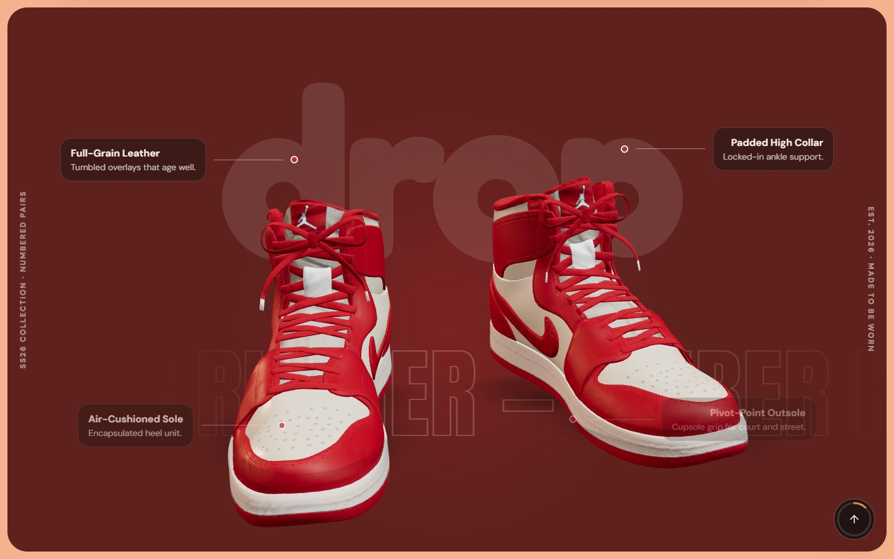 |
| 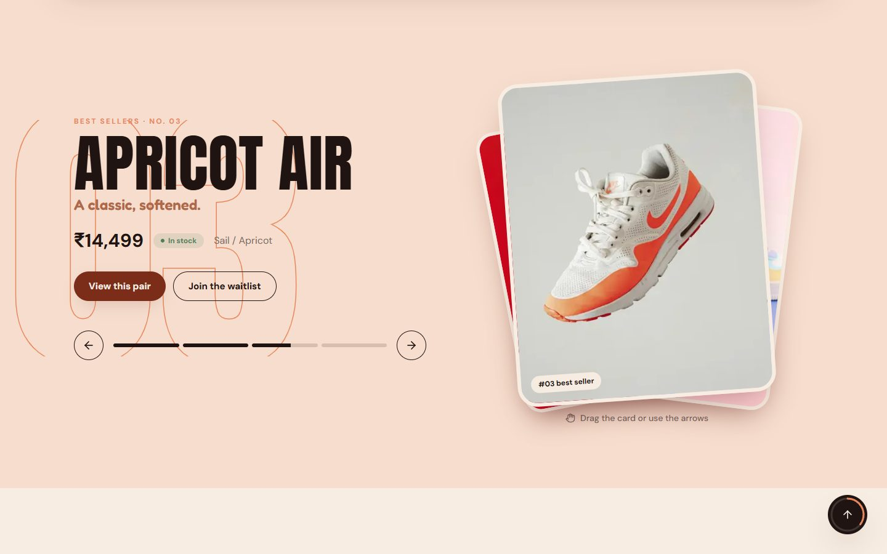 | 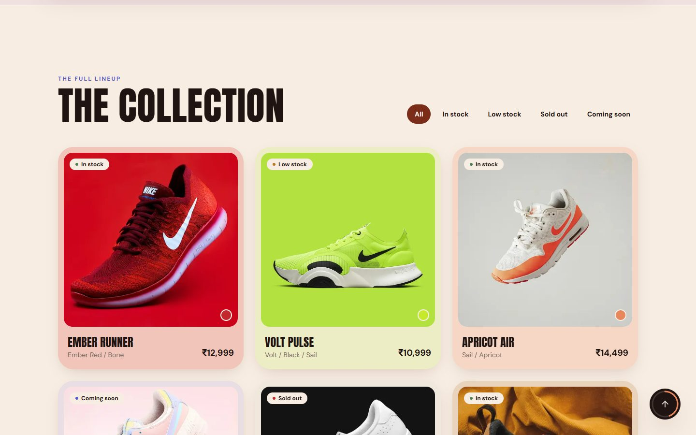 |
| 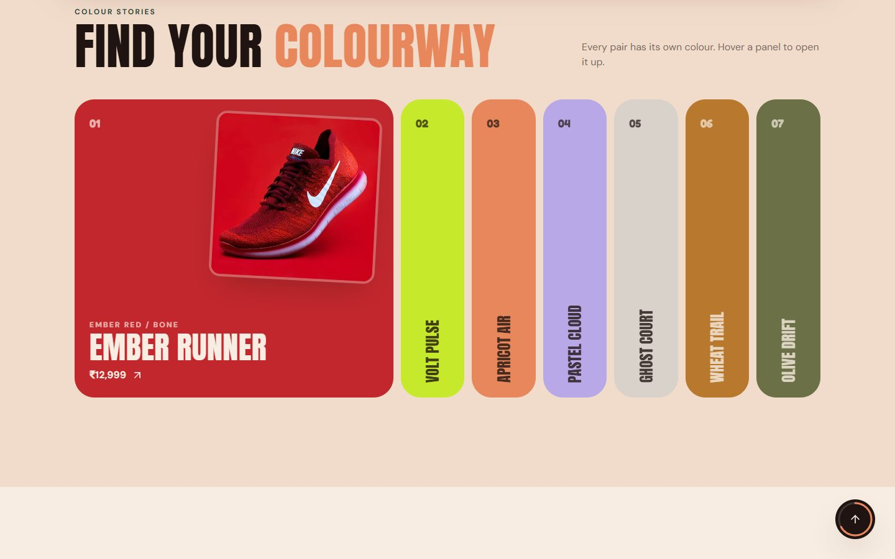 | 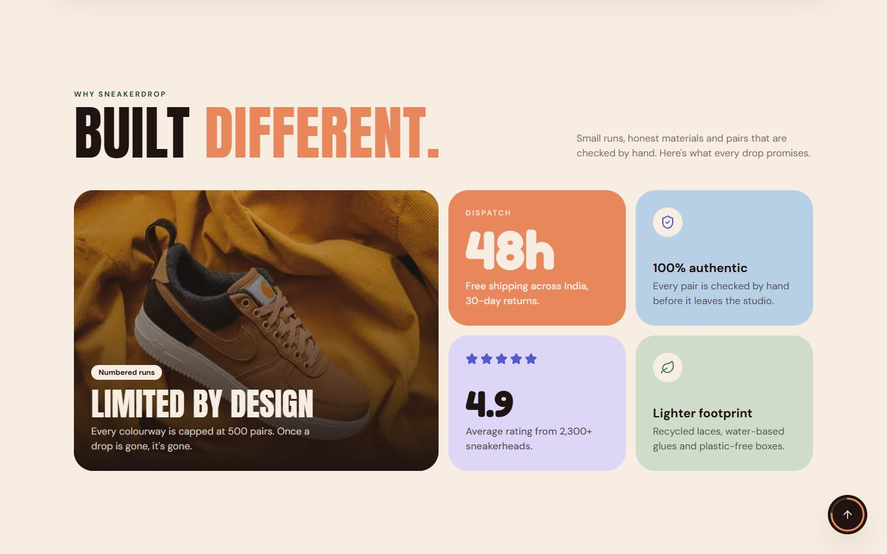 |
| 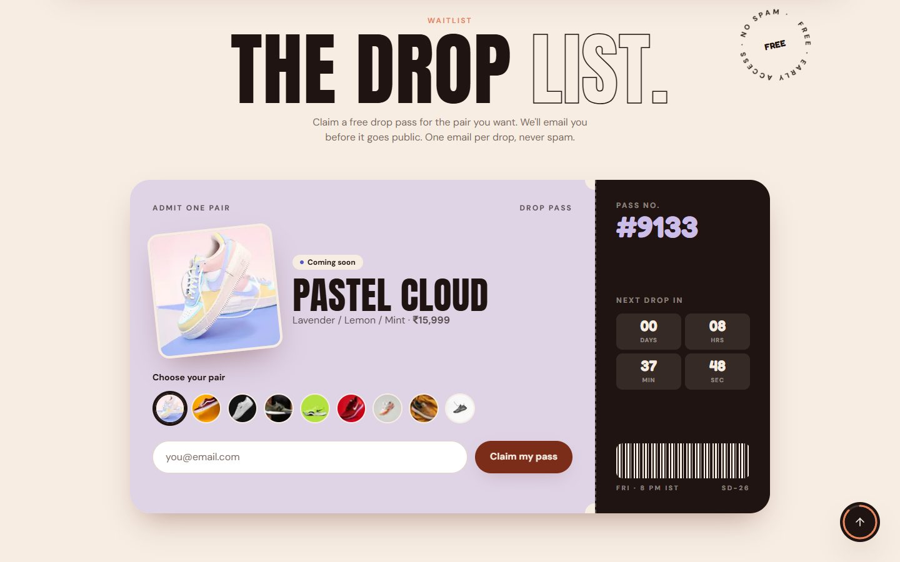 | 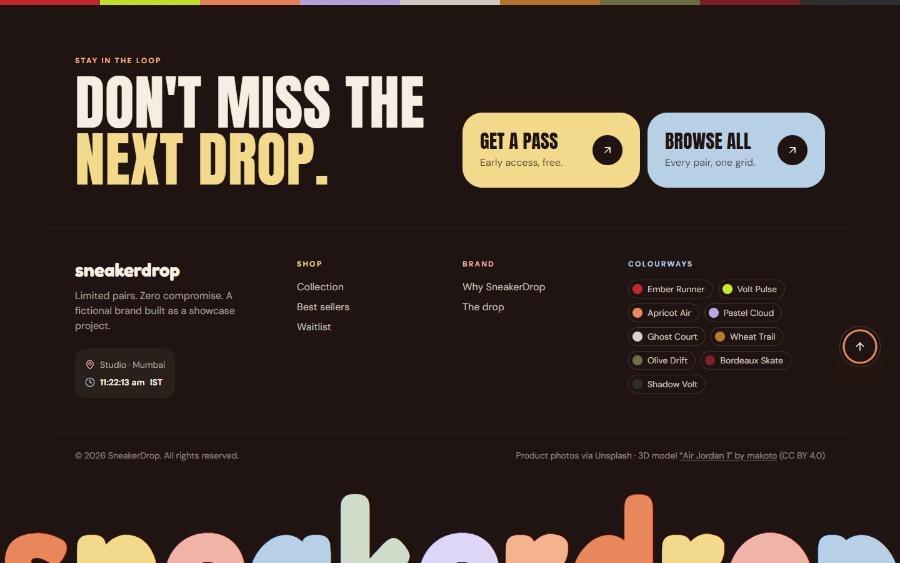 |
| 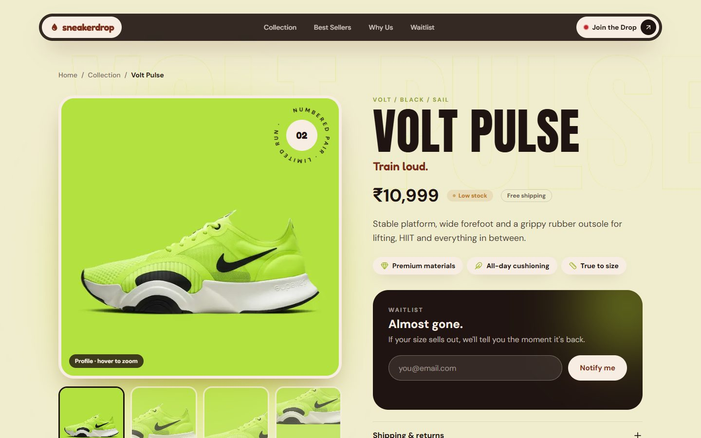 | 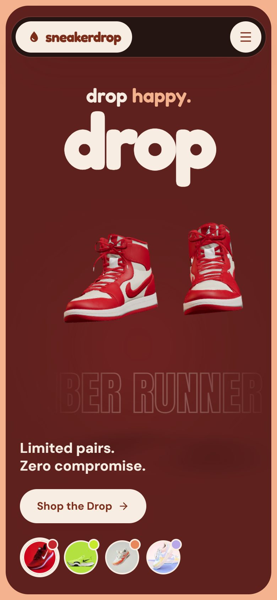 |
| 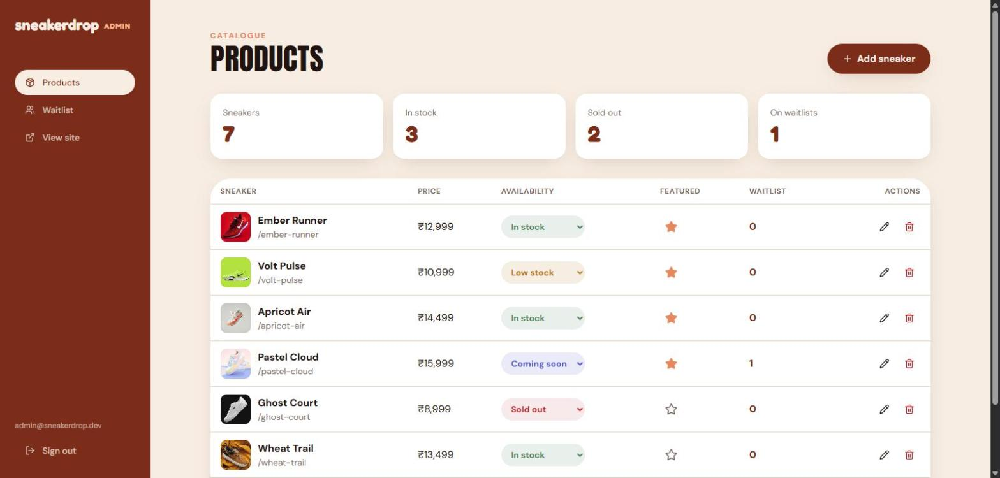 | 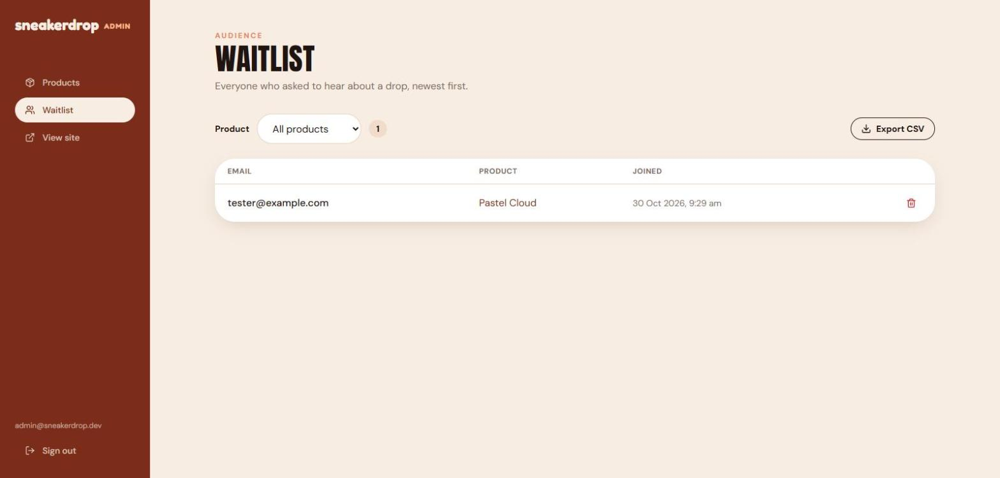 |

---

## Known limitations
- No cart, checkout or payments. This is a showcase, not a shop.
- Waitlist signups are stored but no emails are sent. A Supabase Edge Function plus an email provider would be the next step.
- The hero uses one silhouette (Air Jordan 1) for every product. Only the colour changes. SneakerDrop is fictional and not affiliated with Nike or Jordan Brand.
- Seed photos come from Unsplash and show real-brand sneakers as placeholders. Replace them with your own images through the admin.
- Single admin role. There are no per-admin permissions or audit log.
- Waitlist spam protection is a honeypot plus validation only. There is no rate limiting or CAPTCHA.

## Credits
Product photography: [Unsplash](https://unsplash.com). 3D model: ["Air Jordan 1"](https://sketchfab.com/3d-models/air-jordan-1-a4b434181fbb48008ad460722fd53725) by [makoto](https://sketchfab.com/lu87813), licensed under [CC BY 4.0](https://creativecommons.org/licenses/by/4.0/) and compressed for the web. Air Jordan is a trademark of Nike, Inc. It is used here only as a showcase model for this fictional brand. Fonts: Google Fonts (Fredoka, Anton, DM Sans). Design references: "Mochi" and "Soleship" concept shots in `docs/references/`.
